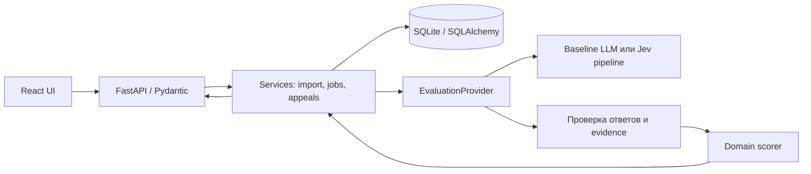

# Архитектура

Один monorepo, один FastAPI backend и один React/TypeScript/Vite frontend.
Это решение команды для короткого хакатона. Сервер владеет состоянием и расчётом.
SQLite/SQLAlchemy запланированы для постоянного хранения, в bootstrap storage не готов.

Services, storage и настоящий provider на схеме — целевой MVP.
В bootstrap работают /health, synthetic demo, domain и mock; остальные HTTP-операции
декларируют контракт, возвращая 501.

## Источники истины и зависимости

- `backend/app/contracts/`: канонические Pydantic DTO, согласует A вместе с C.
- `config/checklists/default.v1.json`: исходная рубрика.
- `backend/app/domain/`: валидация и общий scorer, A.
- `backend/app/evaluation/`: интерфейс, mock и будущий live pipeline, A.
- `backend/app/api/`, `services/`, `storage/`: C.
- `contracts/openapi.json` и `frontend/src/api/generated/`: производные файлы.
- `frontend/`: B; итог не рассчитывает, secrets и provider SDK не содержит.

## Будущий поток оценки

Импорт создаёт ConversationVersion с оригинальным порядком сообщений и content hash.
Изменённый текст — новая версия; прежние сообщения не перезаписываются.
Изменение чек-листа создаёт ChecklistVersion. Запуск Evaluation фиксирует оба snapshot
и настройки provider/model/instruction/pipeline.

Provider получает все активные критерии с определениями ступеней и N/A.
Pipeline проверяет полный набор criterion IDs, типы, допустимость N/A и принадлежность
evidence нужной версии. После этого domain считает результат; только валидная законченная
оценка может иметь полный итог. Ошибка остаётся failed.

Worker допустим внутри backend с ограничением параллелизма и timeout.
Статусы queued/running/succeeded/failed сохраняются; после рестарта прерванные running
получают явную причину отказа и возможность повторного запуска. Это задача C-03.

## Будущий поток апелляции

Appeal связывает Evaluation и criterion_id. ReviewDecision хранит confirm/override,
причину и ключ идемпотентности. Исходные AI-ответы неизменяемы; effective результат
получается применением решений и того же scorer. Решение и пересчёт сохраняются атомарно.
Повтор одного запроса не создаёт дубликат; конфликт решений возвращается явно.

## Evidence и аудио

Ссылка указывает на message_id или диапазон внутри конкретного ConversationVersion.
Цитату UI берёт из snapshot, не из пересказа модели. Проверка существования ссылки
не доказывает её смысловую уместность: это отдельная часть eval.

Сохраняем timestamp_raw. MM:SS чата и ISO timestamp звонка не смешиваются.
Без подтверждённого mapping смещение аудио — null; доступ к записи и переход к
сообщению остаются доступны. Нельзя считать первое сообщение началом аудиозаписи.

## Приватность и воспроизводимость

Импорт источника выполняется сервером с настроенным адресом и group_id;
не создаём публичный proxy произвольных URL. Ручной валидный JSON — офлайн-резерв.
Модель не получает полномочий выполнять содержимое транскрипта.

Результат связывает версии данных, правил, модели и инструкции. Случайные технические
ID не должны влиять на смысл оценки. Кеш не нужен; если появится, ключ включает
содержание и все версии, а не только внешний conversation_id.
